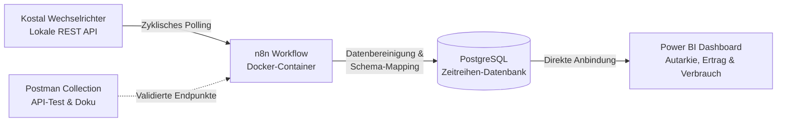
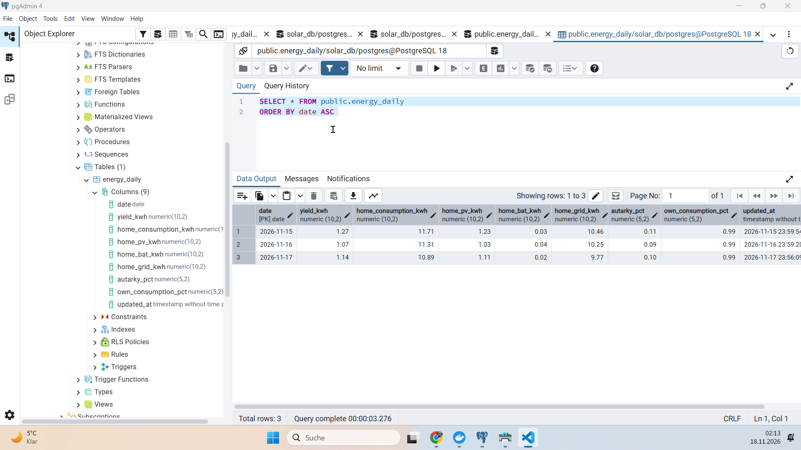

# Kostal Solar Data Pipeline

> **Automatisierte End-to-End-Datenpipeline zum Auslesen, Speichern und Analysieren von Photovoltaik- und Energieflussdaten eines Kostal-Wechselrichters mit n8n, PostgreSQL und Power BI.**



*Datenfluss vom lokalen Kostal-Wechselrichter über die automatisierte n8n-Pipeline in PostgreSQL bis zur Auswertung in Power BI.*

## 1. Idee & Ausgangslage

* **Problem / Ziel:** Standard-Herstellerportale liefern oft nur aggregierte Übersichtswerte und erlauben keine flexiblen eigenen Langzeitanalysen zu Ertrag, Eigenverbrauch, Autarkiegrad oder Einspeisevergütung. Ziel war eine eigene, lokale Datenpipeline, die Messwerte strukturiert erfasst und für detaillierte Auswertungen dauerhaft speichert.
* **Warum dieses Projekt?** Das Projekt verbindet klassische Schnittstellenanalyse und Datenmodellierung mit selbstgehosteter Automatisierung (Docker, n8n, PostgreSQL) und Business Intelligence – ein durchgängiger Praxis-Case von der Rohdaten-API bis zum fertigen Dashboard.

## 2. Lösung im Überblick

Eine lokal betriebene ETL-Pipeline pollt regelmäßig die aktuellen Leistungs- und Verbrauchswerte über die REST-API des Kostal-Wechselrichters, bereinigt die JSON-Antworten und schreibt sie in ein relationales Zeitreihen-Schema in **PostgreSQL**. Darauf aufbauend visualisiert **Power BI** die wichtigsten Energie-KPIs im Zeitverlauf.

```text
Koastal-Solar-Data-Pipeline/
├── README.md                  # Projektdokumentation & Architektur-Überblick
├── assets/                    # Workflow-Screenshots & Power BI Dashboard-Ansichten
├── postman/                   # Exportierte Postman-Collection & Umgebungsvorlage
├── workflows/                 # Exportierter n8n-Workflow (.json)
└── sql/                       # Tabellendefinitionen & Analyse-Abfragen
```

## 3. Projektschritte (End-to-End-Umsetzung)

1. **Anforderungsanalyse & Schnittstellenklärung:** Identifikation verfügbarer lokaler Schnittstellen und Datenstrukturen (REST API / Modbus TCP) sowie Festlegung der relevanten Kennzahlen (aktuelle PV-Erzeugung, Hausverbrauch, Netzeinspeisung, Netzbezug, Batterieladestand).
2. **API-Erkundung & Tests mit Postman:** Aufbau einer Postman-Collection zur gezielten Abfrage der Kostal-REST-Endpunkte, Prüfung der Authentifizierung und Antwortzeiten sowie Dokumentation der JSON-Payloads als Grundlage für die Automatisierung.
3. **Architektur- & Datenbankdesign:** Konzeption der Polling-Intervalle und Fehlertoleranzen (Retries und Logging bei Verbindungsabbrüchen) in **n8n** sowie Aufbau eines relationalen Schemas in **PostgreSQL** zur dauerhaften Speicherung historischer Messreihen.
4. **Implementierung & Automatisierung:** Umsetzung der HTTP-Abfragen in **n8n (Docker)**, Bereinigung und Transformation der Rohdaten in ein einheitliches Zielschema (`timestamp`, `metric`, `unit`, `status`) und automatisiertes Schreiben in PostgreSQL.
5. **Visualisierung & Monitoring:** Anbindung der PostgreSQL-Datenbank an **Power BI** zur Auswertung zentraler Kennzahlen wie Autarkiegrad, täglicher Solarertrag, Netzbezug und Eigenverbrauchsquote im Zeitverlauf.


API-Erkundung & Tests mit Postman


Konzeption der Polling-Intervalle in n8n



Aufbau eines relationalen Schemas in PostgreSQL


Auswertung von Kennzahlen in Power BI

## 4. Verwendete Tools & Technik

* **Postman:** API-Exploration, Authentifizierungstests und Dokumentation der Endpunkte.
* **n8n (Docker):** Zeitgesteuerte Orchestrierung der API-Abfragen, Datentransformation und Fehlerbehandlung.
* **PostgreSQL:** Relationale Datenbank für die strukturierte Speicherung der Energie-Zeitreihen.
* **Power BI:** Datenmodellierung und interaktives Dashboarding der Energieflüsse.
* **Schnittstellen / Protokolle:** Lokale REST API (sowie Modbus TCP als Protokollgrundlage).

## 5. Ergebnisse & Erkenntnisse

* **Durchgängige Datenhoheit:** Alle relevanten PV- und Verbrauchsdaten liegen unabhängig von externen Cloud-Portalen strukturiert in einer eigenen SQL-Datenbank vor.
* **Saubere Trennung von Exploration und Betrieb:** Die vorherige Validierung und Dokumentation der Payloads in Postman hat die Umsetzung und Fehlersuche im n8n-Workflow deutlich beschleunigt.
* **Belastbare Datenbasis für Analysen:** Durch ein einheitliches Zeitreihen-Schema und eingebaute Retry-Logik lassen sich Tages-, Monats- und Jahresvergleiche (z. B. Einspeisevergütung vs. Eigenverbrauchsersparnis) zuverlässig in Power BI abbilden.

## 6. Nächste Schritte / Roadmap

* **Wetterdaten-Korrelation:** Verknüpfung der Ertrags- und Verbrauchsdaten mit historischen Wetterdaten (z. B. DWD-Stationsdaten), um saisonale Einflüsse und Wärmepumpen-Lasten auszuwerten.
* **Automatisierte Anomalie-Benachrichtigung:** Alerting via n8n bei ungewöhnlich niedrigen Erträgen oder längeren API-Ausfällen.
* **Erweiterung der Finanz-KPIs:** Dynamische Berechnung von Ersparnis und Einspeisevergütung bei wechselnden Stromtarifen direkt im SQL-Datenmodell.