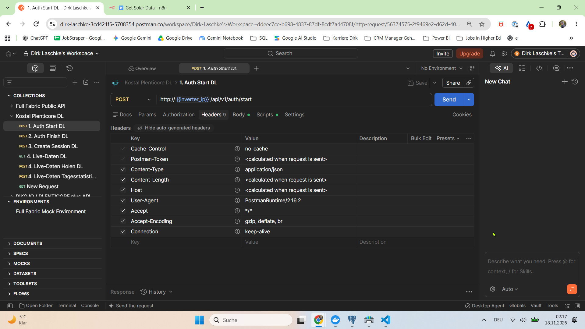
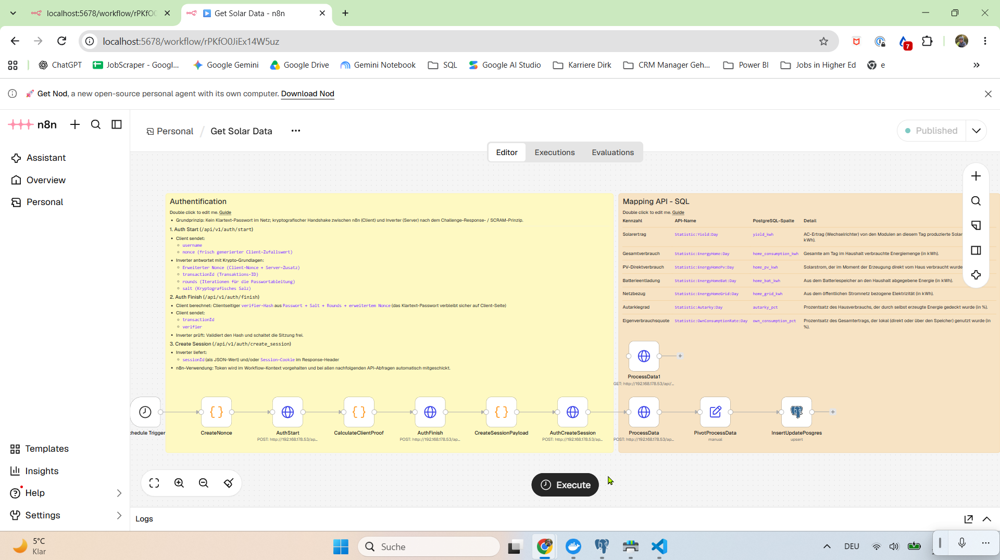
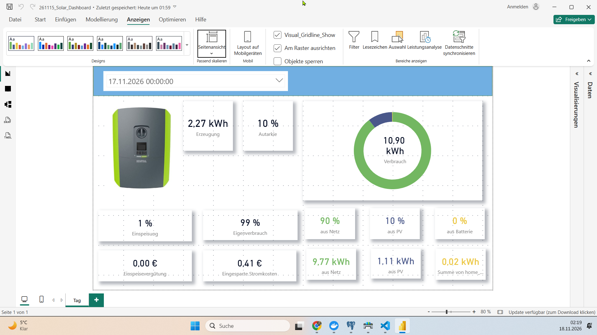

# Kostal Projekt: Integration & Dokumentation

Diese Dokumentation beschreibt Schritt für Schritt die Vorgehensweise, Architektur und Umsetzung im Rahmen des Kostal-Projekts.

## 📋 Übersicht & Zielsetzung
Ziel des Projekts war die Anbindung, Datenerfassung und strukturierte Auswertung von Kostal-Wechselrichter- bzw. Energiemanagement-Daten, um Energieflüsse und Leistungsdaten transparent zu überwachen.

---

## 🚀 Schritt-für-Schritt-Dokumentation

### 1. Anforderungsanalyse & Schnittstellen-Klärung
* **Identifikation der Datenquellen:** Ermittlung der verfügbaren Endpunkte, Protokolle und Datenstrukturen (z. B. Modbus TCP, REST-API oder lokaler Webserver des Kostal-Geräts).
* **Definieren der Zielmetriken:** Festlegung, welche Werte (aktuelle PV-Leistung, Hausverbrauch, Einspeisung, Batterieladestand etc.) regelmäßig ausgelesen werden müssen.

### 2. API-Erkundung & Testing mit Postman
* **Request-Setup:** Erstellung einer Postman-Collection zur gezielten Ansprache der REST-Endpunkte des Kostal-Wechselrichters.
* **Validierung & Auth:** Testen von Authentifizierungsmechanismen (falls erforderlich) und Überprüfen der JSON-Payloads sowie Antwortzeiten.
* **Mocking & Dokumentation:** Dokumentation der Antwortstrukturen für die spätere Implementierung in die Automatisierungs-Pipeline.

### 3. Konzeption der Architektur & Datenpipeline
* **Automatisierungs-Layer:** Aufsetzen von Workflows (z. B. über n8n) unter Verwendung der in Postman validierten Endpunkte zur automatisierten Abfrage in definierten Intervallen.
* **Datenbank-Design:** Einrichtung einer strukturierten relationalen Datenbank (PostgreSQL) zur persistenten Speicherung der historischen Messwerte und Zeitreihen.
* **Schnittstellen-Design:** Definition von Fehlertoleranzen, Retry-Mechanismen bei Verbindungsausfällen und Logging.

### 4. Implementierung & Automatisierung
* **API-/Protokoll-Anbindung:** Aufbau der HTTP-/Modbus-Abfragen in der Automatisierungsumgebung und Validierung der Rohdatenantworten.
* **Datenbereinigung & Transformation:** Mappen der Rohdaten auf ein sauberes Schema (Zeitstempel, Messwert, Einheit, Status).
* **Automatisierte Speicherung:** Schreiben der transformierten Datensätze in die PostgreSQL-Datenbank.

### 5. Visualisierung & Monitoring
* **Anbindung von BI-Tools:** Verknüpfung der Datenbank mit Power BI zur Erstellung von Dashboards.
* **Dashboard-Design:** Visualisierung von Kennzahlen wie Autarkiegrad, täglichem Solarertrag, Netzbezug und Eigenverbrauch im Zeitverlauf.

---

## 🛠️ Verwendeter Tech-Stack
* **API-Testing & Dokumentation:** Postman
* **Automatisierung:** n8n (Docker-basiert)
* **Datenbank:** PostgreSQL
* **Visualisierung:** Power BI
* **Protokolle / Schnittstellen:** REST-API / Modbus TCP
